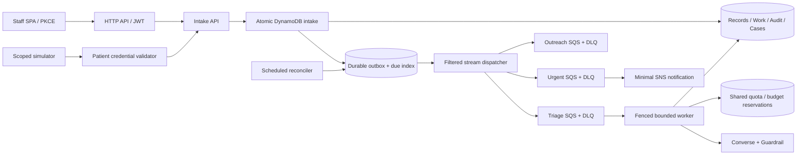

# Tether core design

## Boundaries and current implementation

React/Vite/TypeScript + TanStack Query on Amplify; HTTP API; Python 3.14 FastAPI/Mangum; DynamoDB on-demand; SQS standard lanes; SNS; EventBridge reconciliation; Bedrock Converse and a published Guardrail. Region is us-east-1. Account, identity provider, model and Guardrail remain unverified. Stage A is a browser-only fixture adapter and fail-closed API skeleton. Storage/workers described below are the Stage B–D implementation contract, not deployed behavior.

## Atomic intake and incident identity

Authenticate first. Validate the payload and subject scope before reading idempotency state. Canonicalize the validated request using sorted JSON and hash it with SHA-256. An idempotency key is namespaced by `(tenant, authenticated source, route kind, client ID)`. The source is the validated actor/session/provider identity, never an unchecked body field. `source_message_id` is required for inbound; other writes require `Idempotency-Key`.

Use TransactWriteItems for the idempotency record with digest, message/event intent, job ACCEPTED, audit decision and processing outbox. A keyword hit also creates/updates the active incident case, appends exact evidence and adds an urgent outbox. A conditional failure requires a strongly consistent read: matching digest returns the original IDs with duplicate=true; differing digest gives 409. Rollback gives 503 and no 202. Retain idempotency and incident identities 90 days; source queues retain 4 days, DLQs 14 days; replay older than 90 days requires an explicit new operation and review.

Maintain an active-incident pointer `(tenant,event,patient)` with a generation number. Create a case ID deterministically from that key and generation; conditional updates retry if concurrent messages race. Later evidence joins the active case without lowering severity. Resolving closes the current generation and increments the pointer under the same transaction/version check. A subsequent concerning reply creates a new generation; resolved records are never silently reopened. Notifications use stable `(case_id,severity_revision)` alert identities. Actual email can duplicate around publish/checkpoint crashes.

## State transitions

Jobs: ACCEPTED -> QUEUED -> RUNNING -> SUCCEEDED/HUMAN_REVIEW/FAILED_VISIBLE/CANCELLED. A delivered job may acquire a lease directly from ACCEPTED if dispatch state trails the queue. RUNNING -> QUEUED is allowed only on a recorded retry/recovered expired lease. Any nonterminal job may become FAILED_VISIBLE or CANCELLED through audited reconciliation/cancellation. Terminal states never transition; replay creates a linked new job only after an authorized action. Queue depth is not a job state.

Lease acquisition increments a fencing token and sets lease_until; heartbeat, completion and retry all condition on token + expected job version. Persist a model-attempt reservation before invocation. Persist successful findings before creating subsequent notification work. A stale worker cannot finish after losing its lease. A crashed model call with unknown billing consumes its reserved budget and attempt. SDK total_max_attempts=1; application attempts <=2 including repairs. Expired deadline -> FAILED_VISIBLE. DLQ consumers/reconciliation mark jobs failed-visible and preserve evidence before operator replay.

Patient state: not_contacted/awaiting_reply/reported_safe/needs_help/escalated/unreachable/human_review. Contact state: queued/sent/failed/acknowledged, where sent in this demo means simulated delivery. Model finding is its own immutable record. Case state: OPEN -> ACKNOWLEDGED -> RESOLVED, with assignment independent. Acknowledge requires a coordinator and version. Resolve requires prior acknowledgment, nonblank notes and current version. Email published does not acknowledge. New patient findings update the patient projection only if inbound sequence is current; older findings may append evidence but never downgrade open cases.

## Tables, keys and pagination

All keys include trusted tenant ID. Stage A creates the baseline tables/indexes only; no table scans are authorized for runtime roles.

| Table | Partition / sort key examples | Index and access |
|---|---|---|
| Records | T#t#P#p / PROFILE; T#t#P#p#E#e / MSG#sequence; T#t#E#e / META; T#t#E#e#S#0..7 / STATUS#rank#p | GSI1 PK=T#t#ZIP#zip, SK=P#p for matching; board shards queried in parallel and merged |
| Escalations | T#t#CASE#case / META or EVIDENCE#message; T#t#E#e#P#p / ACTIVE | GSI1 PK=T#t#E#e#CASE#shard, SK=state#severity#time#case |
| Audit | T#t#E#e#S#0..7 / timestamp#audit_id | Query shard merge; application IAM PutItem-only (with conditional insert), no update/delete |
| Work | T#t#JOB#j / META or ATTEMPT#n; T#t#OUTBOX#o / META; T#t#IDEM#source#key / META | GSI1 PK=T#t#DUE#lane#shard, SK=due_at#id; includes pending outbox, leases and follow-up timers |
| Control | T#t#RUN#r / BUDGET; MODEL#id#minute / TOKENS; STAFF#subject / MEMBERSHIP#t | Atomic conservative reservations, server-managed membership; never editable through patient routes |

Eight fixed event shards are an initial design assumption, not measured capacity. The 60-patient demo may use fewer physical items but maintains key shape. No hot per-event completion increment: completion transaction conditionally writes a job outcome plus an idempotent sharded aggregate; reconcile from job records. Global model quota counters intentionally serialize admission and can become the bottleneck; segment by minute/model and measure contention before scaling.

Cursor carries per-shard LastEvaluatedKey, query/filter hash, tenant/event scope and expiry, signed by backend. Page limit 1–50, bounded fan-out, no materialized entire registry. Reject cursor reuse across tenant or filter. GSI reads are eventually consistent: every response includes observed_at; job point reads may be strongly consistent. Counts and rows may momentarily differ; UI says so.

## Authorization

SPA uses Cognito or approved OIDC Authorization Code + PKCE, public client without secret. HTTP API JWT validates issuer, audience, expiry and access scopes (`tether/read` or `tether/write`). Backend loads trusted membership keyed by validated subject and enforces coordinator/viewer/demo_admin roles. JWT tenant claims/body fields do not create membership. Demo admin is a separate role, not an automatic coordinator. Only `/health` is public; OpenAPI is an exported build artifact, not an unauthenticated route.

Simulator session is issued by a coordinator for a specific tenant/patient/event/version, lives 15 minutes and grants only inbound, own thread and own job reads. Use an opaque random 256-bit credential, store its hash and expiry, send through Authorization header, keep only in browser memory. No URL or localStorage token. Its route uses a dedicated validator; it cannot pass staff authorizer or scope checks. Authentication failure 401, same-tenant insufficient role 403, inaccessible object 404. Admin/fault/reset additionally require environment=demo. No admin endpoints enabled in Stage A.

## Model and deterministic policy

Notice extraction and free-text triage are the only required AI jobs. Use canonical schemas and bounded input/output. Prompts separate system instructions from raw untrusted data. Validate exact quotes, numeric bounds, enums and no extra fields. Unknown emergency is an explicit enum. Model confidence is uncalibrated. No treatment/dosing/device-setting advice. Screen serialized tool outputs explicitly through ApplyGuardrail where necessary. Preserve inbound and prior critical evidence if any screening fails. Keywords are a conservative extra layer, not complete detection; negation/quotes/indirect phrasing are evaluation cases. Known emergency evidence survives model refusal.

Before each call reserve tenant/run calls and conservative model tokens atomically, including model-specific output accounting. Refund only demonstrably unused allowance; retain actual usage separately. Caps: 5 calls/run by default, 2 attempts/job, input 4,000 characters (notice 12,000), output 800 tokens; optional agent steps 0 in core. RPS/TPM and token-to-price calculations remain unconfigured until actual model access and rates are known. Initial outreach is deterministic approved templates, max 5 patients/child job, with continuation cursor and event-version check.

## Failures and operations

Stream dispatch publishes before conditional dispatch checkpoint; duplicates are expected. Pending outbox due-index queries recover after stream retention expires. Separate urgent lane avoids AI/outreach starvation. Function timeout 30 seconds, queue visibility 180 seconds, batching window 0, maxReceiveCount 5. Reconciliation runs every minute in Stage D; TTL never schedules work. Timers recheck current event/reply/contact version. Work and outbox survive function deployments; cleanup retains tables by default.

Alarms cover pending outbox age, SQS age/depth, DLQ, API 5xx, Lambda errors/throttles, model throttle and urgent unacknowledged age. Measurements use bounded tenant aggregates with source/window/observed_at. No patient CloudWatch dimension. Single-Region, cellular/provider failure, human staffing and at-least-once external email are explicit limits.
