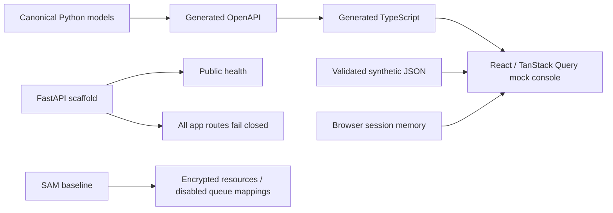

# Architecture

The canonical architecture, state transitions, data keys, boundaries and recovery design are in [the design spec](../.kiro/specs/tether-core/design.md). [Decisions](decisions.md) enumerate changes from the preserved original plan. The implemented Stage A surface is:

No arrow from the current UI reaches AWS. No AWS resources in this diagram are claimed deployed. Stage B introduces authenticated durable transactions, filtered stream dispatch, real workers/model and urgent notification; Stage C connects the complete product; Stage D adds recovery/shared budgets; Stage E produces measured evidence.

Verified implementation references, October 23, 2026: [transactional outbox](https://docs.aws.amazon.com/prescriptive-guidance/latest/cloud-design-patterns/transactional-outbox.html), [Lambda/SQS](https://docs.aws.amazon.com/lambda/latest/dg/services-sqs-configure.html), [JWT authorizer](https://docs.aws.amazon.com/apigateway/latest/developerguide/http-api-jwt-authorizer.html), [Converse API](https://docs.aws.amazon.com/bedrock/latest/APIReference/API_runtime_Converse.html), [Kiro Feature Specs](https://kiro.dev/docs/specs/feature-specs/). Exact selected model capabilities still require a live account test.
